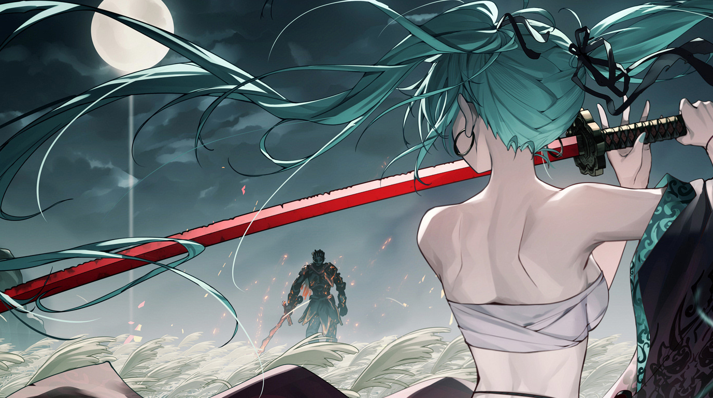

 

 

  

<!-- The snake is generated by .github/workflows/snake.yml, then published on the output branch. -->
<picture>
  <source media="(prefers-color-scheme: dark)" srcset="https://raw.githubusercontent.com/A864329829/A864329829/output/github-snake-dark.svg" />
  <source media="(prefers-color-scheme: light)" srcset="https://raw.githubusercontent.com/A864329829/A864329829/output/github-snake.svg" />
  
</picture>

  

  

 

### Selected Public Repositories

---

